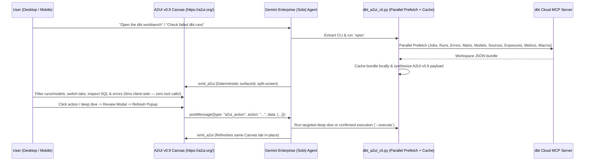

# dbt Cloud MCP — A2UI Workbench Skill

An interactive **Gemini Enterprise (Sobi)** agent skill that pairs the **[A2UI (Agent-to-User Interface)](https://a2ui.org/)** protocol (`v0.9`) with the **dbt Cloud Model Context Protocol (MCP) Server** to turn conversational dbt requests into a fast, action-oriented visual workbench inside the right-hand Canvas.

---

## Built on A2UI ([a2ui.org](https://a2ui.org/))

**[A2UI](https://a2ui.org/)** is an open, declarative Agent-to-User Interface protocol that enables AI agents to render rich, stateful, interactive surfaces (`createSurface`, `updateComponents`) alongside chat and route structured user interactions (`a2ui_action`) safely back to the agent.

Instead of forcing analytics engineers and data consumers to read walls of raw JSON or wait on an LLM round-trip every time they filter a table or switch views, this skill uses A2UI v0.9 (`Canvas` + sandboxed `IFrameSrcdoc` with strict `connect-src 'none'` CSP and 100% pure DOM rendering) to deliver a **bidirectional GUI ↔ Chat loop**:



---

## Core Design Principles

1. **Prefetch-First (`0ms` Browsing & Filtering)**
   - On initial open, [`dbt_a2ui_cli.py`](./scripts/dbt_a2ui_cli.py) executes a two-wave parallel prefetch (`ThreadPoolExecutor`) across workspace jobs, recent runs (all statuses), failed-run error tracebacks, mart & staging models, raw sources (with freshness), BI exposures, governed Semantic Layer metrics, saved queries, macros, plus initial model lineage and metric slices.
   - Switching across all **4 tabs**, filtering runs by status or job, searching resources, toggling chart/table/SQL views, and inserting `{{ ref(...) }}` / `{{ source(...) }}` snippets happen **instantly (`0ms`) client-side** without waiting on extra agent turns.
2. **Clear Review & Guarded Take-Action Workflows**
   - Surfaces failures, active runs, and stale sources immediately at the top of the workbench with 1-click remediation actions.
   - Every mutating job or warehouse compute operation opens a **2-step Confirmation Modal** (`confirmed_in_gui: true`) previewing exact parameters/SQL before execution, then transitions into an animated **Refresh Popup** while the MCP tool runs and refreshes the Canvas.
3. **Additional Tool Calls Strictly Relegated to Deep Dives & Confirmed Executions**
   - Subsequent turns reuse the local session cache (`/tmp/dbt_a2ui_state_cache.json`) and only call dbt Cloud MCP tools when the user explicitly requests a **deep dive** (run artifacts/docs, uncached model lineage/performance, custom MetricFlow slices, AI NL-to-SQL) or confirms an **execution**.

---

## Key Use Cases & Workbench Tabs

### 1. Action Center & Job Runs — *Build Triage, Monitoring & Remediation*
Designed for analytics engineers and on-call data owners who need to see what broke and fix it immediately:
- **Workspace Health KPI Strip:** Instant counts for Failed Runs, Source Freshness Alerts, Marts/Models, and Governed Metrics (each 1-click filterable).
- **"Needs Review & Action" Queue:** Prioritizes failed runs (with root-cause error snippets), active builds, and stale/errored upstream sources.
- **`0ms` Run Explorer + Inline Run Refresh:** Filter up to 40 prefetched runs by status (`All`, `Failed`, `Active`, `Succeeded`, `Cancelled`), by dbt Job, or by live keyword search, and click **Refresh** directly next to **Recent Job Runs** (`dbt_refresh_runs`) to update run statuses and inspect finished run results/logs immediately.
- **Guarded Remediations:**
  - **Safe Retry (`retry_job_run`):** Resume a failed run from the point of failure.
  - **Selective Rebuild (`trigger_job_run`):** Trigger a targeted `dbt build --select +model+` or launch preset runs (`state:modified+`, `dbt test`, `dbt source freshness`).
  - **Cancel Run (`cancel_job_run`):** Stop an active or queued build.
- **On-Demand Deep Dive:** Load step-by-step execution timings, build artifacts (`list_job_run_artifacts`), and contextual dbt Docs troubleshooting (`search_product_docs`).

### 2. Models, Health, Sources & Lineage — *Catalog Discovery & Impact Analysis*
Designed for auditing data freshness, understanding upstream/downstream blast radius, and inspecting model logic:
- **Unified `0ms` Resource Explorer:** Search and chip-filter across **Marts**, **All Models**, **Raw Sources** (with freshness badges), **BI Exposures**, and **Needs Attention** alerts with Master-Detail navigation (`All Resources`).
- **Direct Actions from Any Model:** 1-click **Rebuild `+model+`** or **Query in SQL Runner**.
- **On-Demand Model Deep Dive:** Fetch interactive **Upstream -> Focus -> Downstream Lineage Graphs** (Left-to-Right & Top-Down mobile toggle), column schemas, Compiled SQL vs. Raw Jinja, model health (`get_model_health`), historical execution duration trends (`get_model_performance`), and AI semantic discovery (`get_related_models`).

### 3. Semantic Metric Studio — *Governed MetricFlow Self-Service*
Designed for analysts and business stakeholders exploring governed KPIs from the dbt Semantic Layer:
- **Pre-Hydrated Primary Metric:** Opens with an active governed metric, dimensions, entities, data rows, and compiled MetricFlow SQL ready to inspect.
- **`0ms` View & Catalog Controls:** Toggle instantly between **Visual Bars**, **Data Rows**, and **Compiled SQL**, and search across all governed metrics and saved queries locally.
- **On-Demand Custom Slicing:** Select any metric, time grain (`DAY`, `WEEK`, `MONTH`, `QUARTER`, `YEAR`), and group-by dimension to execute a live MetricFlow query (`query_metrics` + `get_metrics_compiled_sql`).

### 4. Governed SQL & Macro Workbench — *Jinja Authoring, NL-to-SQL & Warehouse Queries*
Designed for rapid ad-hoc data validation using governed dbt references rather than raw table names:
- **`0ms` Reference & Macro Picker:** Filter prefetched Marts, Raw Sources, and dbt Macros and click to insert `SELECT * FROM {{ ref('...') }} LIMIT 25`, `COUNT(*)` checks, or macro invocations directly into the SQL editor.
- **On-Demand AI SQL Generation (`text_to_sql`):** Describe a question in plain English to generate dbt-idiomatic SQL against your project's catalog.
- **Guarded Warehouse Execution (`execute_sql`):** Preview exact SQL in a confirmation modal before executing against the cloud data warehouse and viewing tabular results.

---

## MCP Tool Execution Model (Prefetch vs. Deep Dive vs. Mutation)

| Phase | Trigger | dbt Cloud MCP Tools Invoked |
| :--- | :--- | :--- |
| **Upfront Prefetch (`open`)** | Initial workbench open or explicit `Sync` / project switch | **Wave 1 (Parallel):** `list_projects`, `list_jobs`, `list_jobs_runs`, `get_mart_models`, `get_all_models`, `get_all_sources`, `get_exposures`, `list_metrics`, `list_saved_queries`, `get_all_macros`<br>**Wave 2 (Parallel):** `get_job_run_details` + `get_job_run_error` (failed & latest runs), `get_lineage` + `get_node_details` + `get_model_health` (primary mart), `get_dimensions` + `get_entities` + `query_metrics` + `get_metrics_compiled_sql` (primary metric) |
| **Client-Side Exploration (`0ms`)** | Tab switching, run/model/source/metric/macro search & filtering, chart/table/SQL toggle, staging modals | **None (`0` MCP calls — instant in-browser state)** |
| **Targeted Run Refresh (`incident --refresh-runs`)** | Clicking `Refresh` next to **Recent Job Runs** | `list_jobs_runs` + `get_job_run_details` + `get_job_run_error` (updates run statuses & selected run result/logs in ~1s) |
| **On-Demand Deep Dives** | Clicking `Deep-Dive`, `Run Deep Dive`, `AI Search`, `Run Metric Slice`, or `Generate SQL` | `list_job_run_artifacts`, `search_product_docs`, `get_lineage`, `get_node_details`, `get_model_health`, `get_model_performance`, `get_related_models`, `query_metrics`, `get_metrics_compiled_sql`, `text_to_sql` |
| **Confirmed Executions (`decide --execute`)** | Clicking `Confirm & Execute` in the Confirmation Modal (or explicit chat confirmation) | `retry_job_run`, `trigger_job_run`, `cancel_job_run`, `execute_sql` |

---

## Example Prompts

- *"Open the dbt Cloud workbench"*
- *"Why did last night's dbt build fail, and let me retry or rebuild the broken model"*
- *"Audit upstream source freshness and show downstream dashboard exposures"*
- *"Trace lineage and compiled SQL for `fct_orders`"*
- *"Explore governed Semantic Layer metrics by month"*
- *"Generate dbt SQL for monthly revenue by customer segment"*

---

## Repository Structure

```text
dbt-mcp-a2ui-skill/
├── README.md                 # Architecture, A2UI overview & use-case guide
├── SKILL.md                  # Gemini Enterprise skill instructions + self-extracting CLI payload
└── scripts/
    └── dbt_a2ui_cli.py       # Zero-dependency Python 3 CLI (parallel MCP prefetch + A2UI v0.9 synthesizer)
```

### Rebuilding the Self-Extracting `SKILL.md` Payload & Zip Archive

When modifying [`scripts/dbt_a2ui_cli.py`](./scripts/dbt_a2ui_cli.py), re-embed the compressed `DBT_A2UI_CLI_B64:` payload into [`SKILL.md`](./SKILL.md) (required because Sobi sandbox sessions materialize `SKILL.md` at `/workspace/skills/<skill>/SKILL.md`) and package the zip bundle:

```bash
python3 -W error -m py_compile scripts/dbt_a2ui_cli.py

python3 - <<'PY'
import base64, gzip, pathlib, re, zipfile

cli_path = pathlib.Path("scripts/dbt_a2ui_cli.py")
skill_md = pathlib.Path("SKILL.md")

b64 = base64.b64encode(gzip.compress(cli_path.read_bytes(), mtime=0)).decode("ascii")
updated, n = re.subn(r"DBT_A2UI_CLI_B64:[A-Za-z0-9+/=]+", f"DBT_A2UI_CLI_B64:{b64}", skill_md.read_text())
assert n == 1
skill_md.write_text(updated)

with zipfile.ZipFile("dbt_a2ui_skill.zip", "w", zipfile.ZIP_DEFLATED) as zf:
    zf.write(skill_md, "SKILL.md")
    zf.write(cli_path, "scripts/dbt_a2ui_cli.py")
print("Updated SKILL.md and dbt_a2ui_skill.zip")
PY
```

---

## References

- **A2UI Specification & Documentation:** [https://a2ui.org/](https://a2ui.org/)
- **dbt Cloud Model Context Protocol (MCP):** [https://docs.getdbt.com/docs/dbt-ai/about-mcp](https://docs.getdbt.com/docs/dbt-ai/about-mcp)
