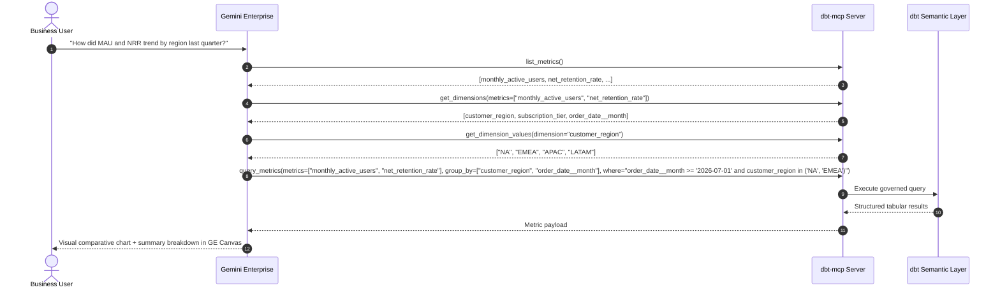
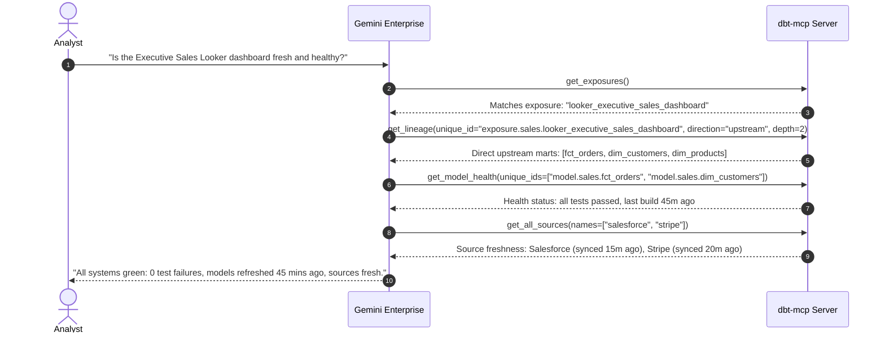
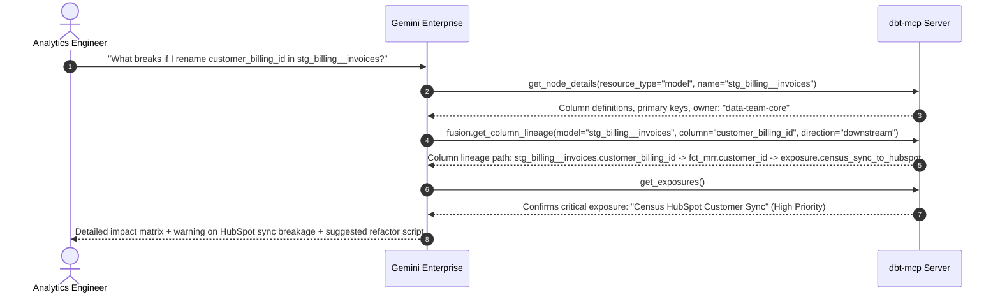

# dbt MCP Workflows for Gemini Enterprise

This document outlines high-impact enterprise workflows that leverage the **dbt MCP Server** within **Gemini Enterprise (GE)** across key enterprise personas.

---

## 1. Business Decision-Makers & Executives

### Workflow: Governed Natural Language Metric Exploration
* **Persona**: VP of Sales, Head of Marketing, Operations Director, Product Lead
* **Business Pain**: Metrics often conflict across departments (e.g., finance vs. marketing revenue). Executives want fast answers without filing data requests or writing SQL, but need guarantees that numbers are trustworthy and consistent.

#### Interaction Flow in Gemini Enterprise
```text
User: "How did our Monthly Active Users (MAU) and Net Retention Rate (NRR) trend across North America vs EMEA last quarter?"
```



#### Tools Leveraged
* `list_metrics`: Identifies approved enterprise metric definitions.
* `get_dimensions`: Verifies dimensional compatibility across multiple requested metrics.
* `get_dimension_values`: Resolves colloquial region names ("North America", "Europe") to canonical warehouse values (`"NA"`, `"EMEA"`).
* `query_metrics`: Queries the dbt Semantic Layer directly, ensuring joins, deduplication, and aggregation logic remain compliant with central definitions.

#### Gemini Enterprise Experience
* Results are rendered in the **Right-Hand Canvas** as an interactive table or chart (via A2UI / Sheets connector) rather than raw text.

---

## 2. Business & Financial Analysts

### Workflow: "Is This Data Safe?" — Freshness & Upstream Health Audit (Metrics, Queries & Exposures)
* **Persona**: BI Developer, Financial Analyst, Growth Marketing Analyst, Business User
* **Business Pain**: When answering critical business questions—whether querying a metric via the Semantic Layer, executing an exploratory SQL query, or presenting a Looker/Tableau dashboard—analysts and decision-makers need immediate verification: *When was this data last calculated? Did upstream tests pass? Are raw sources stale?*

#### Supported Entry Points & Interaction Flows in Gemini Enterprise

##### Path A: Semantic Layer Metric Query with Health Status
```text
User: "What was our Monthly Active Users (MAU) last month, and what is the health status of this metric?"
```
* **Tools**: `query_metrics` + `get_model_health` + `get_all_sources` + `get_lineage`
* **Flow**:
  1. Gemini invokes `query_metrics(metrics=["monthly_active_users"], ...)` to retrieve the governed calculation.
  2. Simultaneously retrieves health signals for the underlying semantic model via `get_model_health(unique_ids=["semantic_model.core.users"])`.
  3. Validates upstream ingestion latency via `get_all_sources`.
  4. Returns the metric value alongside an integrated **Data Trust Badge**: *"MAU = 142,500 (Healthy: Built 35m ago, 18/18 tests passed, upstream sources fresh)"*.

##### Path B: Exploratory SQL Query Execution with Data Provenance
```text
User: "Run a query on `mart_exec_sales` to get revenue by product tier, and tell me when it was last refreshed and if tests passed."
```
* **Tools**: `execute_sql` (or `text_to_sql`) + `get_model_health` + `get_node_details`
* **Flow**:
  1. Gemini executes the query via `execute_sql(sql="select product_tier, sum(revenue) ... from mart_exec_sales ...")`.
  2. Fetches model health metadata via `get_model_health(unique_ids=["model.sales.mart_exec_sales"])`.
  3. Displays the resulting dataset in Gemini Canvas accompanied by an inline **dbt Health Tile**:
     - `✔ Model materialized successfully (Snowflake, 42m ago)`
     - `✔ 12/12 data tests passed (unique, not_null, accepted_values)`
     - `✔ Upstream Salesforce & Stripe sources within SLA`

##### Path C: Downstream BI Exposure Audit (Looker / Tableau / PowerBI)
```text
User: "I have to present our Executive Sales Dashboard in Looker in 20 minutes. Is the data fresh, and did the nightly dbt runs pass?"
```



#### Tools Leveraged
* `query_metrics` / `list_metrics`: Executes governed metric inquiries with Semantic Layer context.
* `execute_sql` / `text_to_sql`: Runs ad-hoc or natural-language warehouse queries with compile-time safety.
* `get_model_health`: Inspects run outcomes, model build timestamps, and test pass/fail metrics.
* `get_all_sources`: Inspects upstream source freshness (Stripe, Salesforce, Kafka).
* `get_lineage`: Traverses the upstream DAG to trace metric, model, or exposure provenance.
* `get_exposures`: Resolves downstream BI reports and operational syncs registered in dbt.

#### Gemini Enterprise Experience
* Displays an executive-ready health checklist in GE Chat and opens an interactive **Health & Freshness Workbench** in the right-hand Canvas.
* Features a responsive lineage mini-map that renders **Left-to-Right** on desktop screens and shifts seamlessly to **Top-Down** on mobile and narrow split-screen viewports.

---

## 3. Analytics Engineers & Data Developers

### Workflow: Pre-Migration Column-Level Impact Analysis
* **Persona**: Analytics Engineer, Data Platform Engineer
* **Business Pain**: Modifying or deprecating a column in a core staging model (e.g., `stg_stripe__charges`) often risks silently breaking downstream business marts, reverse ETL pipelines, or machine learning models.

#### Interaction Flow in Gemini Enterprise
```text
User: "We plan to rename `customer_billing_id` in `stg_billing__invoices`. What downstream models, columns, and dashboards will be impacted?"
```



#### Tools Leveraged
* `get_node_details`: Inspects model definitions, descriptions, tags, and column types.
* `fusion.get_column_lineage`: Traces column lineage downstream through complex SQL joins and transformations.
* `get_exposures`: Identifies high-risk business exposures (e.g., reverse ETL, Looker explores).
* `generate_model_yaml`: Generates the updated YAML specification with downstream descriptions preserved.

#### Gemini Enterprise Experience
* Gemini displays a visual column-level dependency diagram in the Canvas, flagging breaking paths in amber/red.

---

## 4. DataOps & Incident Responders

### Workflow: Automated Production Pipeline Diagnosis & Safe Retry
* **Persona**: On-Call Data Engineer, Analytics Team Lead
* **Business Pain**: Production dbt Cloud jobs fail in the middle of the night. Engineers waste time opening dbt Cloud, filtering megabytes of raw CLI logs to locate the single syntax error or upstream test failure, and deciding whether it's safe to retry.

#### Interaction Flow in Gemini Enterprise
```text
User: "The 3:00 AM production nightly run failed. What caused the failure, and can we safely re-run it?"
```

```mermaid
sequenceDiagram
    autonumber
    actor Engineer as On-Call Engineer
    participant GE as Gemini Enterprise
    participant MCP as dbt-mcp Server
    participant dbtCloud as dbt Cloud Admin API

    Engineer->>GE: "Why did the 3:00 AM production job fail?"
    GE->>MCP: list_jobs_runs(status="error", limit=1)
    MCP-->>GE: Run #98124 (Job: "Nightly Production Build", Status: Error)
    GE->>MCP: get_job_run_error(run_id=98124)
    MCP-->>GE: Error in step 3: "Database Error in model fct_daily_usage: Query timeout after 300s (upstream lock in Snowflake)"
    GE->>MCP: get_job_run_details(run_id=98124)
    MCP-->>GE: 142/145 models built successfully; only 3 downstream models skipped
    GE-->>Engineer: "Summary: Transient database lock/timeout on fct_daily_usage. 142 models succeeded. Recommend running a targeted retry."
    Engineer->>GE: "Proceed with retrying the failed job."
    GE->>MCP: retry_job_run(run_id=98124)
    MCP->>dbtCloud: POST /runs/98124/retry
    dbtCloud-->>MCP: New Run #98125 triggered
    MCP-->>GE: Run #98125 queued
    GE-->>Engineer: "Run #98125 triggered for the 3 remaining models."
```

#### Tools Leveraged
* `list_jobs_runs`: Discovers recent failed executions without needing run IDs upfront.
* `get_job_run_error`: Extracts the exact compiled SQL error or assertion failure without downloading megabytes of logs.
* `get_job_run_artifacts`: Inspects `run_results.json` with targeted `jq_filter` for fine-grained step timings.
* `retry_job_run`: Executes a restart of only the failed and downstream-skipped nodes.

#### Gemini Enterprise Experience
* Destructive or triggering actions (`retry_job_run`, `cancel_job_run`) surface Gemini's interactive approval buttons before firing.

---

## 5. Domain Data Teams & Cross-Project Mesh Consumers

### Workflow: Cross-Project dbt Mesh Discovery & Contract Consumption
* **Persona**: Product Data Scientist, Marketing Analyst building cross-functional models
* **Business Pain**: Teams in decentralized data mesh architectures often recreate existing tables (e.g., customer profiles or finance revenue) because they cannot discover whether a producer domain already publishes a contracted public model.

#### Interaction Flow in Gemini Enterprise
```text
User: "I need to join our marketing attribution data with verified ARR and customer contract tiers. Does the Finance or Core team have a public mesh model for this?"
```

#### Tools Leveraged
* `search_public_mesh_models`: Scans across connected dbt projects for models flagged as `access: public` with active model contracts.
* `get_node_details`: Confirms the schema contract, versioning (`v1`, `v2`), and owner contact info.
* `get_model_performance`: Checks execution stability and average build duration before taking an upstream dependency.

#### Outcome
* Gemini returns the exact cross-project `{{ config(...) }}` snippet:
  ```sql
  select
      customer_id,
      current_contract_tier,
      annual_recurring_revenue
  from {{ ref('finance_core', 'dim_customer_contracts', v=1) }}
  ```

---

## Summary Matrix: Value Delivered

| Enterprise Persona | Primary Tools | GE Experience | Business Outcome |
| :--- | :--- | :--- | :--- |
| **C-Suite & Business Leads** | `list_metrics`, `query_metrics`, `get_dimensions` | Natural language chat + Canvas visualizations | Self-serve trusted metrics; zero semantic divergence |
| **Business & BI Analysts** | `query_metrics`, `execute_sql`, `get_model_health`, `get_all_sources`, `get_exposures` | Traffic-light health cards + responsive Canvas audit workbench | High confidence in ad-hoc queries, metrics & dashboards; instant SLA verification |
| **Analytics Engineers** | `fusion.get_column_lineage`, `get_lineage`, `get_node_details` | Interactive DAG viewer (`ui://dbt-mcp/get-lineage`) | Safe refactoring; prevents breaking downstream BI/reverse-ETL |
| **DataOps / On-Call** | `get_job_run_error`, `get_job_run_artifacts`, `retry_job_run` | Actionable incident summaries + one-click retry | Fast MTTR (Mean Time to Resolution); no log digging |
| **Mesh Consumers** | `search_public_mesh_models`, `get_node_details` | Searchable contract catalog in Canvas | Cross-domain code reuse; eliminates duplicate pipelines |
